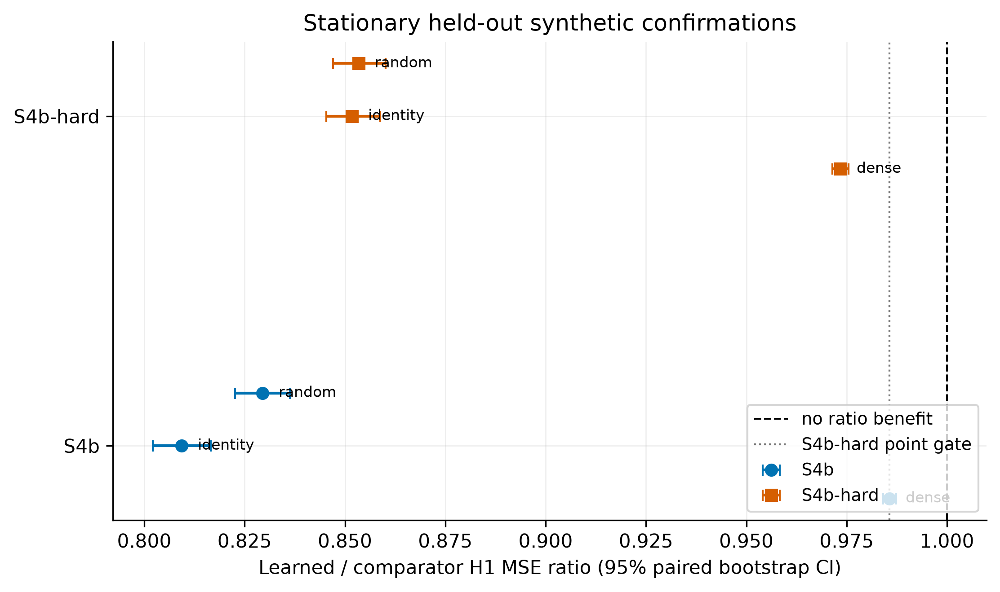
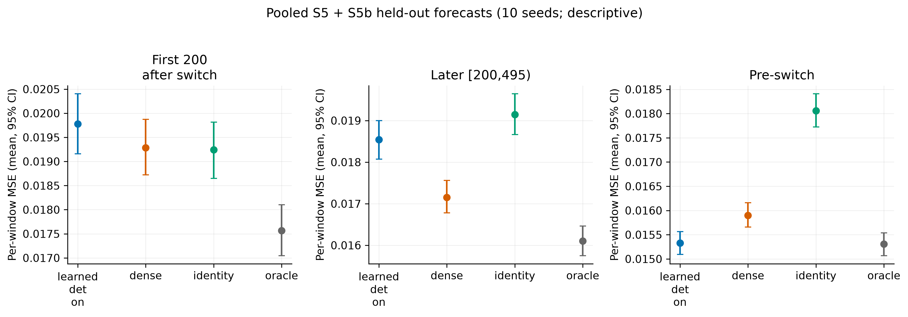

# OCG-SSM: Online Causal-Graph-Conditioned State-Space Forecasting

[](https://github.com/Aadip-Thapaliya/ocgssm/actions/workflows/tests.yml)
[](https://github.com/Aadip-Thapaliya/ocgssm/actions/workflows/citation.yml)


[](LICENSE)

OCG-SSM is a multivariate time-series forecaster developed for a master's
thesis at the University of Europe for Applied Sciences. It learns a sparse,
lagged dependency graph between the input variables and uses that graph to
decide which variables may influence each other inside a state-space model
written in pure PyTorch. During online forecasting the graph keeps learning,
and a regime-switch detector speeds up graph adaptation when the
data-generating process changes.

The thesis asks a narrow question: **does conditioning a state-space
forecaster on a learned dependency graph reduce forecast error compared with
the same model given no cross-variable edges, all edges, or random edges, and
does online graph adaptation help after an abrupt change?** Every experiment
was run under a protocol that was frozen and committed before any held-out
data was built, and negative results are reported as they came out.

## Contents

- [Highlights](#highlights)
- [How it works](#how-it-works)
  - [Graph learner](#1-graph-learner)
  - [Graph-conditioned SSM](#2-graph-conditioned-state-space-model)
  - [Regime detector and online updates](#3-regime-detector-and-online-updates)
  - [Graph modes and baselines](#4-graph-modes-and-baselines)
- [Repository layout](#repository-layout)
- [Installation](#installation)
- [Quick start](#quick-start)
  - [Command line](#command-line)
  - [Python API](#python-api)
  - [Configuration files](#configuration-files)
  - [Output format](#output-format)
- [Tests and continuous integration](#tests-and-continuous-integration)
- [Data](#data)
- [Evaluation protocol](#evaluation-protocol)
- [Results](#results)
- [Claims and their status](#claims-and-their-status)
- [Limitations](#limitations)
- [Reproducing the thesis](#reproducing-the-thesis)
- [Citation](#citation)
- [Acknowledgements](#acknowledgements)
- [License](#license)

## Highlights

- **Learned graph helps on stationary data.** On held-out stationary
  synthetic data the learned graph beat dense, random and identity graphs,
  with 95% confidence intervals entirely below a ratio of 1.
- **No benefit after a graph switch.** After an abrupt change, online dense
  adaptation was as good as or better than the learned graph.
- **DLinear wins on real data.** On ETTh1 and ETTh2 the learned graph was at
  least as good as dense, but DLinear had 15-73% lower MSE in every
  evaluated case.
- **Pre-registered gates.** Each stage's pass/fail conditions were committed
  to git before its held-out data was built, and the code checks this.
- **Fully reproducible tables.** One command rebuilds every thesis table and
  figure from the committed stage summaries.

## How it works

Notation: D variables, K lags, N state size per variable, L input window
length, H forecast horizon.

### 1. Graph learner

`src/ocg/graph.py` (`GraphLearner`)

- The graph is a set of lagged logits `Lg` with shape (K, D, D). Edge
  probabilities are `A^k = sigmoid(Lg[k] / tau)`, where `A^k[i, j]` is the
  edge from `x_j(t-k)` to `x_i(t)`. Because every edge points forward in
  time, the graph is acyclic by construction and needs no DAG constraint.
- The graph is trained on its own structural objective, a masked linear VAR:

  ```
  S(G) = mean_t || x_t - sum_k (A^k * W^k) x_{t-k} ||^2  +  lambda * sum_k |A^k|
  ```

  `W^k` are learned VAR weights and `lambda` is the sparsity weight. This
  gives the graph a training signal that does not depend on the forecaster.
- The forecaster reads an exponential moving average (EMA) of the logits, so
  the graph it uses changes smoothly.
- Forecast parameters and graph parameters have separate optimizers.

### 2. Graph-conditioned state-space model

`src/ocg/ssm.py` (`CausalSSMLayer`), `src/ocg/model.py` (`CausalSSM`)

Each variable i has its own hidden state `h_t[i]` of size N:

```
dt          = softplus(Linear([x_t[i], e_i]))
decay       = exp(-dt * exp(logA))                       # diagonal
coupling[i] = sum_j A[i, j] * W h_{t-1}[j]               # only along graph edges
h_t[i]      = decay * h_{t-1}[i] + gate * coupling[i] + dt * B([x_t[i], e_i]) * x_t[i]
y_t[i]      = C([x_t[i], e_i]) . h_t[i]
```

- `e_i` is a graph-aware node embedding built from the node's own embedding
  and its neighbours' embeddings.
- Before each scan the off-diagonal adjacency and the coupling projection are
  divided by `max(1, spectral norm)`. The coupling gate is limited to the
  decay budget left over, so cross-variable recurrence cannot blow up the
  hidden state.
- The scan is a plain sequential loop in PyTorch: linear in L and
  O(D^2 N) per step. It runs on CPU; no custom kernels are needed.
- Input windows are normalised with reversible instance normalisation
  (RevIN). A direct lag head and a forecast head map the final state to an
  (H, D) forecast.

### 3. Regime detector and online updates

`src/ocg/graph.py` (`RegimeDetector`), `src/ocg/fast_graph.py`,
`src/ocg/train.py` (`train_online`)

- Online evaluation is **prequential**: every window is forecast first, and
  its targets become available for training only once they have been
  observed. Nothing from the future is used.
- The detector is calibrated on validation structural scores (robust
  median/MAD baseline), then frozen. It flags a window when the z-score of
  the structural score exceeds a threshold for a set number of consecutive
  steps, and then re-arms after a normal streak.
- On a detection, the graph learning rate is multiplied by `boost` for
  `boost_steps` steps.
- `fast_graph.py` adds the S5b variant (`learned_fast`): the EMA is reset on
  detection and the graph is refit from a replay buffer of already-observed
  windows.

### 4. Graph modes and baselines

The same `CausalSSM` runs with five graph modes, so that only the graph
differs between comparisons:

| Mode | Graph used |
|---|---|
| `identity` | self-lags only, no cross-variable edges |
| `dense` | every edge, including self-lags |
| `random` | random edges at the same density as the learned graph |
| `oracle` | the true generator graph (synthetic data only) |
| `learned` | the graph learned by `GraphLearner` |

External baselines in `src/ocg/baselines.py`:

| Baseline | Description |
|---|---|
| `var_direct` | DirectVAR: linear VAR fitted directly to each horizon |
| `dlinear` | DLinear: trend/seasonal decomposition with linear heads |
| `revin_linear` | RevIN with a single linear layer |
| `transformer_lite` | small temporal Transformer forecaster with a mean-value skip |
| `no_graph_ssm` | SSM without any graph conditioning |

## Repository layout

```
ocgssm/
├── src/ocg/
│   ├── data.py           synthetic SVAR generator, CSV loader, windowing, RevIN
│   ├── graph.py          GraphLearner (lagged graph + masked VAR) and RegimeDetector
│   ├── fast_graph.py     EMA reset and replay-buffer graph updates (S5b)
│   ├── ssm.py            graph-conditioned SSM layer
│   ├── model.py          CausalSSM forecaster and graph modes
│   ├── baselines.py      DirectVAR, DLinear, RevIN-Linear, Transformer-lite, NoGraph-SSM
│   ├── train.py          offline and prequential online training
│   ├── eval.py           forecast, graph-recovery, adaptation and efficiency metrics
│   └── run.py            config-driven command-line runner
├── tests/                pytest suite (96 tests)
├── configs/              YAML configs for the command-line runner
├── scripts/              thesis stage runners (roadmap_*.py) and the export script
├── results/
│   ├── roadmap/          frozen stage protocols (gates.yaml) and stage summaries
│   ├── thesis_export_c2/ thesis tables (CSV) and figures (PNG, PDF)
│   └── d20_equal_training/  D20 protocol files used by the tests
├── notebooks/            Google Colab notebook for GPU runs
├── data/                 ETT CSVs go here (not tracked)
├── .github/workflows/    CI: tests and CITATION.cff validation
├── CITATION.cff
├── LICENSE
├── pyproject.toml
└── requirements.txt
```

## Installation

Python 3.12 is recommended; the pinned requirements and CI use it. The thesis
runs used Python 3.12.12 on a laptop CPU (Intel i7-13700H).

```bash
git clone https://github.com/Aadip-Thapaliya/ocgssm.git
cd ocgssm
python -m venv .venv
source .venv/bin/activate        # Windows: .venv\Scripts\activate
python -m pip install -r requirements.txt
python -m pip install -e .
```

`requirements.txt` pins the exact versions used for the thesis. On Linux,
the default PyTorch wheel includes CUDA libraries. For a smaller CPU-only
install, run this before the requirements:

```bash
python -m pip install torch==2.15.0 --index-url https://download.pytorch.org/whl/cpu
```

For GPU runs, install a CUDA build of PyTorch and pass `--device cuda`, or
use the Colab notebook below.

## Quick start

### Command line

Run a small synthetic experiment with an abrupt graph switch:

```bash
python -m ocg.run --config configs/synthetic_abrupt.yaml --output results/synthetic_abrupt.json --device cpu
```

| Option | Meaning |
|---|---|
| `--config` | experiment YAML (required) |
| `--output` | JSON output path; default `results/<config>.json` |
| `--data-path` | CSV path for real-data configs, overriding the config |
| `--device` | torch device, for example `cpu` or `cuda` |

Real-data example:

```bash
python -m ocg.run --config configs/ett.yaml --data-path data/ETTh1.csv --output results/ett.json
```

### Python API

```python
import torch
from ocg.data import generate_svar, make_windows
from ocg.graph import GraphLearner
from ocg.model import CausalSSM

torch.manual_seed(0)
data = generate_svar(n_steps=600, n_variables=5, n_lags=2, switch_at=600, seed=0)
inputs, targets = make_windows(data["series"], input_length=24, horizon=6)
# inputs: (571, 24, 5), targets: (571, 6, 5)

learner = GraphLearner(n_variables=5, n_lags=2)
model = CausalSSM(n_variables=5, state_dim=8, horizon=6, n_lags=2,
                  graph_mode="learned", graph_learner=learner)
forecast = model(inputs[:32])          # (32, 6, 5)

learner.offline_update(inputs[:32])    # one structural-objective step on the graph
adjacency = learner.adjacency()        # (K, D, D) edge probabilities from the EMA logits
```

`generate_svar` returns `series` (T, D), the true `graph` (T, K, D, D) and the
`coefficients` at every time step, so graph recovery can be scored exactly.

### Configuration files

| Config | Purpose |
|---|---|
| `synthetic_abrupt.yaml` | 5-variable SVAR, abrupt graph switch, online cold start |
| `synthetic_gradual.yaml` | same, with a gradual blend between graphs |
| `ablation.yaml` | all five graph modes on the same data |
| `stress.yaml` | 8 variables, 3 lags, longer window and horizon, offline training |
| `sanity_d20.yaml` | 20-variable offline sanity benchmark |
| `research_online.yaml` | matched online graph controls and baselines |
| `ett.yaml`, `electricity.yaml`, `traffic.yaml` | real-data configs (CSV not included) |

A config has three sections:

```yaml
data:      # source (synthetic or csv), size, switch point, window length, horizon, splits
model:     # name (ocg or a baseline), graph_mode, state_dim, graph learner and detector settings
training:  # mode (offline or online), online_start, epochs, batch_size, learning_rate
```

A `model.variants` list runs several models on identical data in one call.

### Output format

The runner writes one JSON file with, per variant:

- forecast MSE and MAE per horizon;
- graph-recovery scores against the true graph (SHD, F1, precision,
  recall, AUROC), aligned to the timestamp of each forecast;
- online adaptation metrics: detection delay, sustained recovery time and
  regret against the oracle variant;
- efficiency: milliseconds per step, peak memory and parameter count.

## Tests and continuous integration

```bash
python -m pytest
```

The suite has 96 tests covering data generation, the graph learner and
detector, the SSM, the full model, training loops, metrics, baselines, the
command-line runner and the thesis scripts. One test is skipped when
`data/ETTh1.csv` is not present.

GitHub Actions runs two workflows:

- **Tests** (`.github/workflows/tests.yml`): installs the pinned
  requirements with CPU PyTorch and runs `pytest` on every push to `main` and
  every pull request.
- **Citation** (`.github/workflows/citation.yml`): validates `CITATION.cff`
  with `cffconvert` when it changes.

## Data

**Synthetic.** All synthetic stages use a sparse structural VAR generated in
code from fixed seeds (`ocg.data.generate_svar`). Coefficients are rescaled
so the companion spectral radius is below 0.9, innovations are
N(0, 0.1²), and the graph can switch abruptly or blend gradually at a chosen
time step. No download is needed.

**Real.** The S6 stage uses ETTh1 and ETTh2 (Electricity Transformer
Temperature, hourly; 7 variables) from the ETDataset repository
(https://github.com/zhouhaoyi/ETDataset). Download the two files and place
them in `data/`:

```bash
curl -L -o data/ETTh1.csv https://raw.githubusercontent.com/zhouhaoyi/ETDataset/main/ETT-small/ETTh1.csv
curl -L -o data/ETTh2.csv https://raw.githubusercontent.com/zhouhaoyi/ETDataset/main/ETT-small/ETTh2.csv
```

The CSVs are not redistributed in this repository. ETDataset is published
under CC BY-ND 4.0; check the upstream repository for the current terms.
S6 uses a chronological train/validation/test split, and standardisation
statistics come from the training split only.

## Evaluation protocol

- **Frozen gates.** Each stage has a `gates.yaml` or `protocol.yaml` under
  `results/roadmap/` that states the seeds, variants and pass conditions.
  The file was committed before any held-out data for that stage was built.
  The stage scripts check that the file is committed and unchanged, and
  refuse to build held-out data otherwise.
- **Seeds.** Development pairs (data seed / model seed) 67/1009, 71/1103 and
  73/1201 were used for tuning. Each held-out stage used fresh pairs that
  had never been looked at, and pairs used in earlier exploration were
  marked as burned and blocked in code.
- **Splits.** Synthetic: targets up to index 3199 for development, 3200-3999
  for held-out test. Real data: chronological train/validation/test.
- **Statistics.** Primary results are equal-seed mean-MSE ratios
  (A / B < 1 means A is better) or mean-MSE differences, with paired
  circular block-bootstrap 95% confidence intervals (2000 resamples; block
  of 12 windows for synthetic data and 96 for real data).
- **Determinism.** Every run uses `torch.set_num_threads(1)` and is
  deterministic for a fixed data and model seed pair.

## Results

All numbers below are copied from the stage summaries; the full per-horizon
tables are in `results/thesis_export_c2/`. H1 means horizon 1.

### Stage overview

| Stage | Question | Outcome |
|---|---|---|
| S1 | Is the oracle-graph model close to DirectVAR on development data? | PASS (oracle / DirectVAR H1 1.029) |
| S1b | Does an SSM residual on a masked VAR backbone help? | no gain |
| S3 | Has the learned graph converged by the epoch cap? | PASS (0/3 cap hits; < 0.05% gain after epoch 20) |
| S2 | Development: is learned close to oracle and better than dense/random? | PASS |
| S2d | Does the graph benefit grow as training data shrinks? | yes on development data; D20 with 600 training steps chosen for S4-hard |
| S4 | Held-out, test slice containing a graph switch | FAIL (0 of 4 gate conditions) |
| S4b | Held-out, stationary (no switch) | PASS (4 of 4) |
| S4b-hard | Held-out, stationary, D20 with 600 training steps | PASS (4 of 4) |
| S5 | Online adaptation after an abrupt switch | FAIL against dense online |
| S5b | EMA reset plus replay-buffer graph updates | FAIL against dense online, not retried |
| S6 | Real data (ETTh1, ETTh2) | learned at least matches dense; DLinear better |
| S6b | Five-seed real-data follow-up | not run |

### Development stages (S1-S3)

| Comparison (H1) | Ratio [95% CI] |
|---|---|
| S1 oracle / DirectVAR | 1.0288 [1.0198, 1.0380] |
| S2 learned / oracle | 1.0059 [1.0036, 1.0083] |
| S2 learned / dense | 0.9839 [0.9811, 0.9868] |
| S2 learned / random | 0.8360 [0.8232, 0.8497] |
| S2 learned / identity | 0.8243 |
| S2d learned / dense, D20 with 600 training steps | 0.9712 [0.9680, 0.9743] |

On development data the learned graph is within 1% of the oracle graph and
beats every other graph mode. The SSM itself trails a plain DirectVAR by
about 3% even with the true graph.

### Stationary synthetic data: supported

| Stage | learned / dense | learned / random | learned / identity |
|---|---|---|---|
| S4b | 0.9857 [0.9841, 0.9874] | 0.8295 [0.8227, 0.8363] | 0.8093 [0.8021, 0.8166] |
| S4b-hard | 0.9735 [0.9715, 0.9754] | 0.8534 [0.8471, 0.8601] | 0.8518 [0.8453, 0.8588] |



The gain over the dense graph is small (1.4-2.7% at H1) but its interval is
entirely below 1. It is larger in the data-scarce S4b-hard setting, matching
the S2d trend. The gain fades at longer horizons.

### After a graph switch: not supported

- **S4.** Held-out learned / dense H1 0.9999 [0.9974, 1.0024]. An audit
  found that the generator switches graph at t = 3600, inside the test slice
  3200-3999, and 395 of 771 test windows are fully post-switch. The frozen
  FAIL stands; S4b repeats the test without a switch.
- **S5** (first 200 windows after the switch, 5 held-out seeds). Learned
  with detector minus frozen learned: -0.001661 [-0.001831, -0.001502], so
  online adaptation helps. Learned with detector minus dense online:
  +0.000117 [+0.000026, +0.000211], so dense adapts better.
- **S5b** (EMA reset and replay). learned_fast minus dense online:
  +0.001084 [+0.000846, +0.001334]. The gate failed and was not retried.
- **Pooled S5 + S5b** (10 seeds, descriptive). Learned with detector minus
  dense online is +0.000496 [+0.000369, +0.000633] in the first 200 windows
  and +0.001391 [+0.001205, +0.001574] in windows 200-495. Before the
  switch, learned beats dense: -0.000573 [-0.000646, -0.000507].



### Real data: DLinear is stronger

| Case | learned / dense | learned / identity | learned / DLinear |
|---|---|---|---|
| ETTh1, H24 | 0.9731 [0.9622, 0.9834] | 0.9479 [0.9305, 0.9668] | 1.733 |
| ETTh1, H96 | 0.9967 [0.9898, 1.0034] | 0.9753 [0.9667, 0.9845] | 1.553 |
| ETTh2, H24 | 0.9907 [0.9839, 0.9973] | 0.9828 [0.9761, 0.9893] | 1.153 |
| ETTh2, H96 | incomplete (2 of 3 seeds) | incomplete | incomplete |

The learned graph beats dense at H24 on both datasets, with no
interval-supported gain at H96. DLinear has lower error than OCG-SSM in every
evaluated case. Learned real-data graphs are not stable across seeds (top-10
edge Jaccard 0.25-0.43 on ETTh1, 0-0.18 on ETTh2) and are not causal claims.

### Scope

- Stationary synthetic data: supported.
- Learned graph versus dense after a switch: not supported.
- Real data: DLinear is stronger.
- Online adaptation on real data: not tested.

## Claims and their status

| Claim | Status |
|---|---|
| The learned graph recovers the true lagged graph on stationary synthetic data | supported, synthetic only (D20 AUROC 0.9999, F1 0.986) |
| On stationary held-out data, learned beats dense, random and identity | supported (S4b, S4b-hard) |
| The graph benefit grows as training data shrinks | supported on development and stationary D20 data |
| Learned stays within 5% of oracle on held-out data | not supported (S4 learned / oracle H1 1.093) |
| OCG-SSM matches a direct VAR | not supported (about 3-5% behind) |
| Online adaptation beats a frozen model after a switch | supported (S5) |
| Online learned graph beats online dense after a switch | not supported (S5, S5b, pooled) |
| The learned graph tracks the new graph after a switch | not supported (top-edge F1 0.23-0.37 in the first 200 windows) |
| The detector finds switches without false alarms | not supported (false alarms in 2 of 10 runs) |
| The learned graph helps against dense on ETT at H24 | supported (ETTh1, ETTh2) |
| The learned graph helps against dense on ETT at H96 | not supported (ETTh1); inconclusive (ETTh2) |
| OCG-SSM is competitive with strong real-data baselines | not supported (DLinear better) |

## Limitations

- **Small effects.** Significant synthetic gains over dense are 1-3%.
- **Synthetic graph identification only.** Graph recovery is shown only on a
  synthetic SVAR. Real-data graphs have no ground truth.
- **Forecaster strength.** The SSM is 3-5% behind a plain DirectVAR on
  synthetic data, and DLinear is clearly better on ETT.
- **Noise floor.** Synthetic innovations have variance 0.01, so the
  irreducible H1 MSE is 0.01. The oracle-graph SSM is about 6.6% above that.
- **Training caps.** Many runs hit their epoch cap under the frozen training
  policy, so some models may be under-trained.
- **Few seeds.** Three seeds for S2, S4 and S6, five for S5 and S5b.
- **Incomplete cases.** ETTh2 H96 is incomplete and S6b was not run. Online
  adaptation on real data and other datasets (Weather, ETTm1) were not
  evaluated.
- **Timing.** Some recorded `elapsed_seconds` values are inflated by laptop
  standby. Results are deterministic and unaffected; only those timings are
  invalid.

## Reproducing the thesis

Run all commands from the repository root after installation.

**Rebuild the tables and figures** in `results/thesis_export_c2/` from the
committed stage summaries in `results/roadmap/` (takes seconds):

```bash
python -m scripts.export_thesis_assets_c2
```

The CSV and PNG files come out byte-identical to the committed ones; the
PDFs differ only in embedded metadata.

**Rerun the experiments** behind each table. These train models and take
several hours in total on a laptop CPU. Held-out stages only run while their
frozen `gates.yaml` is committed and unchanged.

| Table | Commands |
|---|---|
| `S1.csv` | `python -m scripts.roadmap_s1 --stage s1` |
| `S1b.csv` | `python -m scripts.roadmap_s1 --stage s1b` |
| `S1_diagnostics.csv` | `python -m scripts.roadmap_s1_diagnostics` |
| `S3.csv` | `python -m scripts.roadmap_s3` |
| `S2.csv` | `python -m scripts.roadmap_final --stage s2`, then `--stage s2 --summarize` |
| `S2d.csv` | `python -m scripts.roadmap_final --stage s2d`, then `--stage s2d --summarize` |
| `S4.csv`, `S4-hard.csv` | `python -m scripts.roadmap_final --stage s4 --pairs 0,1,2`, then `--stage s4 --summarize` |
| `S4b.csv` | `python -m scripts.roadmap_s4b --pairs 0,1,2`, then `--summarize` |
| `S4b-hard.csv` | `python -m scripts.roadmap_s4b_hard --pairs 0`, `--pairs 1`, `--pairs 2`, then `--summarize` |
| `S5.csv` | `python -m scripts.roadmap_s5 --phase tuning`, `--phase select`, `--phase heldout --pairs 0,1,2,3,4`, then `--phase heldout --summarize` |
| `S5b.csv` | `python -m scripts.roadmap_s5b --phase tune --pair P --cand C` for P in 0..2 and C in 0..5, `--phase select`, `--phase heldout --pair P --variant all` for P in 0..4, then `--phase summarize` |
| `S6.csv` | `python -m scripts.roadmap_s6 --dataset ETTh1 --horizon 24`, the same with `--horizon 96` and with `--dataset ETTh2`, then `--summarize` |
| `S5_S5b_pooled.csv`, `saturation_diagnostic.csv` | `python -m scripts.roadmap_continuation2` (reads saved outputs only) |
| `S6b.csv` | not run; the table records this |

After rerunning stages, run the export command again to rebuild the tables.

## Citation

If you use this code, please cite it. GitHub's "Cite this repository" button
reads [`CITATION.cff`](CITATION.cff). BibTeX:

```bibtex
@software{thapaliya_ocgssm_2026,
  author  = {Thapaliya, Aadip},
  title   = {{OCG-SSM}: Online Causal-Graph-Conditioned State-Space Forecasting},
  year    = {2026},
  url     = {https://github.com/Aadip-Thapaliya/ocgssm},
  version = {thesis-final}
}
```

## Acknowledgements

- ETDataset by Haoyi Zhou et al. (https://github.com/zhouhaoyi/ETDataset)
  provides the ETTh1 and ETTh2 data.
- The DLinear baseline follows Zeng et al., "Are Transformers Effective for
  Time Series Forecasting?" (AAAI 2023).
- RevIN follows Kim et al., "Reversible Instance Normalization for Accurate
  Time-Series Forecasting against Distribution Shift" (ICLR 2022).

## License

The code is released under the [MIT License](LICENSE). The ETT data is not
part of this repository and keeps its own licence.
