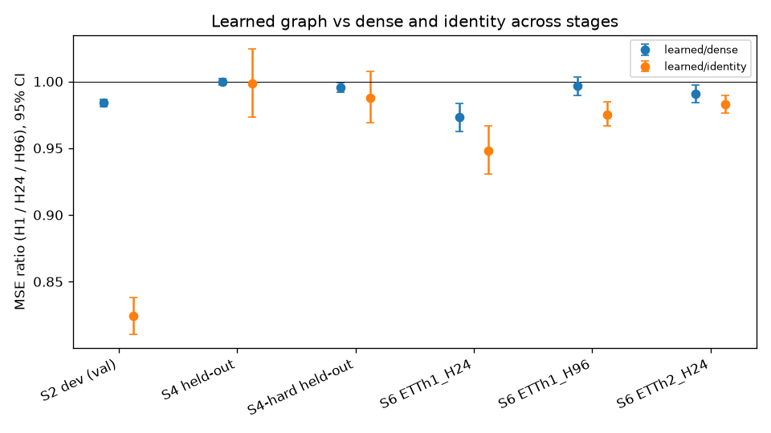
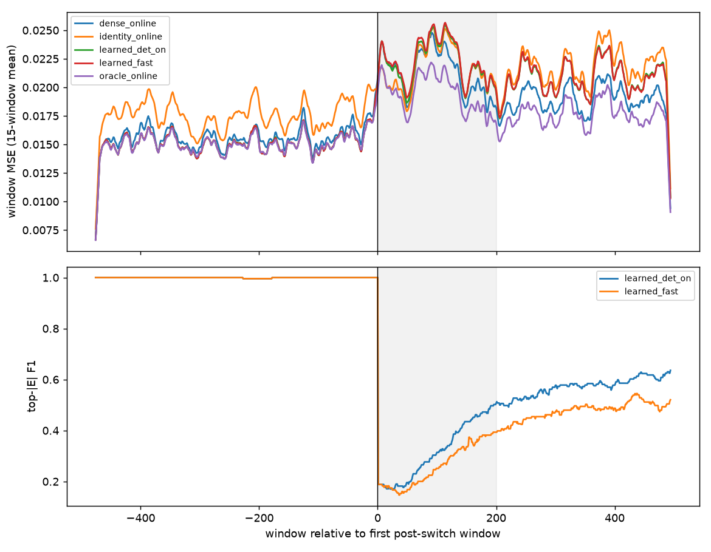

# OCG-SSM thesis results (final roadmap S1-S6, with continuation)

All numbers come from committed summaries under `results/roadmap/` and are reported exactly. Ratios are equal-seed mean-MSE ratios (A/B < 1 means A is better). Intervals are paired circular block bootstrap 95% CIs with 2000 resamples (block 12 windows for synthetic data, 96 for real data). Gates were frozen and committed before each evaluation; held-out data were built only after the commit (asserted in code). The mission is in `docs/MISSION_FINAL.md`, the decision log in `docs/PLAN.md`/`docs/DIAGNOSTICS.md`, and reproduction steps in `docs/REPRODUCE.md`.

## Stage table

| Stage | Data / seeds | Gate (frozen) | Result | Key ratios [95% CI] | Wall runtime | Artifacts |
|---|---|---|---|---|---|---|
| S1 head | D20 synthetic, dev, validation | oracle/DirectVAR <= 1.05 at H1, H2 | **PASS** (iterated head) | oracle/DirectVAR H1 1.0288 [1.0198, 1.0380], H2 1.0333 [1.0260, 1.0413] | 18 min | results/roadmap/s1/s1 |
| S1 diag + S1b | dev, validation | user-directed OLS diagnostic | S1b no gain; iterated kept | oracle about 3% above DirectVAR, about 5-6% above oracle-support OLS | - | results/roadmap/s1/{diagnostics,s1b} |
| S3 convergence | dev, validation | cap hits / late gain | **PASS** | 0/3 cap hits at 40 epochs; gain after epoch 20 < 0.05% | - | results/roadmap/s1/s3 |
| S2 formal | dev 67/1009, 71/1103, 73/1201; gate slice 2933-3199 | learned/oracle <= 1.05 H1,H2; learned/dense CI<1 H1,H2; learned/random CI<1 H1 | **PASS** (learned_soft) | learned/oracle H1 1.0059 [1.0036, 1.0083]; learned/dense H1 0.9839 [0.9811, 0.9868], H2 0.9904 [0.9886, 0.9924]; learned/random H1 0.8360 [0.8232, 0.8497]; learned/identity H1 0.8243; learned/var_direct H1 1.035 | 40 min | results/roadmap/final/s2 |
| S2d scarcity | dev, validation | choose S4-hard | D20_T600 chosen | learned/dense H1: T600 0.9712 [0.9680, 0.9743], T1200 0.9770, T2400 0.9839, D10 0.9890, D40 0.9761; oracle/dense H1 0.926-0.987 | about 90 min (budget 60) | results/roadmap/final/s2d (s2d_scarcity.png) |
| **S4 held-out** | 53/709, 59/811, 61/913; test 3200-3999 | learned/dense CI<1 H1; learned/random CI<1 H1; learned/identity CI<1 H1,H2 | **FAIL -> F2** (0/4 conditions) | learned/dense H1 0.9999 [0.9974, 1.0024]; learned/random 0.9926 [0.9705, 1.0162]; learned/identity H1 0.9983 [0.9731, 1.0241], H2 1.0005 [0.9835, 1.0183]; learned/oracle H1 1.093, H2 1.054 (secondary fail); learned/var_direct 1.045; learned/dlinear 1.042 | about 62 min | results/roadmap/final/s4 |
| **S4b stationary confirmation** | 103/1801, 107/1907, 109/2003; no switch; test 3200-3999 | same S4 primary conditions | **PASS** (4/4) | learned/dense H1 0.9857 [0.9841, 0.9874]; learned/random 0.8295 [0.8227, 0.8363]; learned/identity H1 0.8093 [0.8021, 0.8166], H2 0.8747 [0.8678, 0.8816]; learned/oracle 1.0063/1.0039 H1/H2 | 20m55s | results/roadmap/final/continuation/s4b |
| S4-hard (secondary) | held-out, D20_T600 | evidence only | - | learned/dense H1 0.9955 [0.9919, 0.9992]; learned/identity 0.988 [0.969, 1.007]; learned/oracle 1.078 | (included) | results/roadmap/final/s4 |
| **S5 held-out** | 79/1301, 83/1409, 89/1511, 97/1613, 101/1709; first 200 post-switch windows | det_on - frozen CI<0; det_on - dense_online CI<0 | **FAIL -> F3** | det_on - frozen -0.001661 [-0.001831, -0.001502] (pass); det_on - dense_online +0.000117 [+0.000026, +0.000211] (fail); det_on - det_off -0.000196 [-0.000230, -0.000166]; det_on - identity_online +0.000527 | about 5.8 h (budget 3.5 h + approved 2 h 15 min) | results/roadmap/final/s5 (heldout/s5_post_switch.png) |
| **S5b learned_fast** | dev-only tuning; held-out 113/2111, 127/2203, 131/2309, 137/2411, 139/2503; first 200 post-switch windows | learned_fast - dense_online CI upper < 0 | **FAIL** (no retry) | learned_fast - dense_online +0.001084 [+0.000846, +0.001334]; learned_fast - learned_det_on +0.000209 [+0.000169, +0.000249]; descriptive [200,495): fast - dense +0.001883 [+0.001568, +0.002212] | 2h07m total (53m37s tuning + 1h02m held-out; within 3.5 h) | results/roadmap/final/continuation/s5b (summary + timeline plot) |
| S6 ETTh1 H24 | real, seeds 1009/1103/1201 | target learned <= dense; benefit claim needs CI<1 | **met, CI-supported** | learned/dense 0.9731 [0.9622, 0.9834]; learned/identity 0.9479 [0.9305, 0.9668]; learned/dlinear 1.733 | S6 total about 4.8 h (budget 3 h) | results/roadmap/final/s6 |
| S6 ETTh1 H96 | real | same | met (point), **no CI benefit** | learned/dense 0.9967 [0.9898, 1.0034]; learned/identity 0.9753 [0.9667, 0.9845]; learned/dlinear 1.553 | | results/roadmap/final/s6 |
| S6 ETTh2 H24 | real | same | **met, CI-supported** | learned/dense 0.9907 [0.9839, 0.9973]; learned/identity 0.9828 [0.9761, 0.9893]; learned/dlinear 1.153 | | results/roadmap/final/s6 |
| S6 ETTh2 H96 | real | same | **INCOMPLETE** (2/3 original seeds; not run in continuation) | not evaluated | | - |
| Optional S6b follow-up | ETTh1/ETTh2, H24/H96, 5 seeds; previously examined test sets | learned < dense with CI upper < 1 and learned <= DLinear | **NOT RUN** (full design did not fit remaining experiment budget plus docs reserve) | no new outcomes | - | - |

**S4 slice-design audit.** The generator changes graph at t=3600 for every original S4 pair; test raw slice 3200-3999 therefore is not stationary. With 24-step inputs and 6-step targets, saved S4 runs contain 371 windows whose targets are all pre-switch, 5 straddling windows, and 395 fully post-switch windows (targets [3600,3993]). The post-switch graph shares only 6-9% of edges with the training graph. The original D20 reduced pairs 37/401, 43/503, 47/607 used the same switch and test slice, so they also had the switch inside the test slice; those saved run files did not retain per-window timestamps, so their counts are derived from the frozen protocol and windowing code. The original S4 remains a frozen FAIL. S4b changes only the generator to no switch and confirms a stationary held-out benefit; it does not retroactively alter S4.

Pre-switch-only S4 windows (targets < 3600, descriptive, not a gate): learned/dense H1 0.9841 [0.9816, 0.9864], learned/identity 0.8134, learned/random 0.8249, learned/oracle 1.0053. These gains explain why the mixed-regime S4 result was poor but do not rescue its frozen gate.

**S5 pre-switch descriptive table** (per-window MSE, paired circular block bootstrap over 471 windows/seed, 12-window blocks, 2000 resamples; not a gate):

| Variant | Mean MSE [95% CI] |
|---|---:|
| identity_online | 0.01854 [0.01802, 0.01906] |
| dense_online | 0.01618 [0.01577, 0.01658] |
| random_online | 0.01806 [0.01757, 0.01855] |
| learned_frozen | 0.01538 [0.01501, 0.01573] |
| learned_det_off | 0.01554 [0.01514, 0.01591] |
| learned_det_on | 0.01554 [0.01516, 0.01592] |
| oracle_online | 0.01554 [0.01514, 0.01591] |

S5 post-switch windows are indexed from the first wholly post-switch window: [0,200) is the frozen gate, [200,495) and [0,495) are truncated and **post hoc, descriptive** because only 495 post-switch windows exist. The complete variant means and paired CIs for these windows are in `results/roadmap/final/continuation/task0/task0.md`.

## Claims

| Claim | Status | Evidence |
|---|---|---|
| The learned graph recovers the true lagged graph on stationary synthetic data | SUPPORTED (synthetic only) | Earlier diagnostics: D20 AUROC 0.9999, F1 0.986; S5 pre-switch top-|E| F1 about 1.0 |
| On development seeds the learned graph is close to oracle and beats dense/random/identity | SUPPORTED (dev, validation) | S2 PASS |
| On held-out synthetic data the learned graph beats dense | NOT SUPPORTED (F2) | S4 learned/dense H1 0.9999 [0.9974, 1.0024] |
| On held-out synthetic data the learned graph beats identity and random | NOT SUPPORTED on the frozen slice | S4 CIs include 1; pre-switch descriptive gains only |
| On stationary held-out D20, learned beats dense, random, and identity | SUPPORTED (S4b; corrected stationary slice design) | S4b passes all four frozen primary conditions; learned/dense H1 0.9857 [0.9841, 0.9874] |
| The learned graph stays within 5% of oracle on held-out data | NOT SUPPORTED | S4 learned/oracle H1 1.093, H2 1.054 |
| The graph benefit grows with data scarcity | SUPPORTED on dev; weak on held-out | S2d trend 0.971 to 0.984; S4-hard learned/dense 0.9955 CI < 1 (secondary only) |
| The OCG-SSM matches a direct VAR | NOT SUPPORTED | learned/var_direct 1.035 (S2), 1.045 (S4); even oracle is about 3% above DirectVAR (S1) |
| Online adaptation with the detector beats the frozen model after a switch | SUPPORTED | S5 det_on - frozen CI < 0 on 5 held-out seeds |
| Online adaptation with the learned graph beats dense online after a switch | NOT SUPPORTED (F3) | det_on - dense_online +0.000117 [0.000026, 0.000211]; identity_online is better still |
| EMA reset plus replay-buffer graph updates let learned_fast beat dense_online | NOT SUPPORTED (S5b) | learned_fast - dense_online +0.001084 [+0.000846, +0.001334] over the frozen first-200 gate |
| EMA reset plus replay improves graph tracking over learned_det_on | NOT SUPPORTED | S5b top-|E| F1 over first 200 post-switch windows is lower for learned_fast (0.197-0.360) than learned_det_on (0.269-0.439) across the five seeds |
| The detector finds the switch quickly without false alarms | SUPPORTED (synthetic) | 5/5 detected, 0 false alarms, delay 2-12 steps; det_on beats det_off by 0.000196 MSE |
| The learned graph tracks the post-switch graph | NOT SUPPORTED | post-switch top-|E| F1 0.23-0.37 over the first 200 windows |
| The learned graph helps on real data versus dense | PARTIAL: SUPPORTED at H24 (ETTh1, ETTh2); NOT SUPPORTED at ETTh1 H96; INCONCLUSIVE at ETTh2 H96 | S6 |
| OCG-SSM is competitive with strong real-data baselines | NOT SUPPORTED | DLinear better by 15-73% MSE in every S6 case |
| Learned real-data graphs are stable or causal | INCONCLUSIVE | No ground truth; top-10 Jaccard across seeds 0.25-0.43 (ETTh1), 0-0.18 (ETTh2) |

## Limits
- Effects are small. The significant synthetic gains are 1-3% versus dense, and held-out gains vanish over the full frozen slice.
- Graph identification is shown only on a synthetic SVAR generator. The real-data graphs have no ground truth and are not causal claims.
- The SSM forecaster is about 3-5% behind a plain direct VAR on synthetic data. On real data DLinear dominates.
- **Noise-floor qualification.** Synthetic innovations are N(0, 0.1²) in raw units, so the irreducible one-step MSE is 0.01, and only at H1. The implied oracle-support OLS H1 MSE is about 0.0101, within about 1% of that floor, while the SSM oracle is about 6.6% above it. A normalized ratio alone does not imply proximity to the floor, and no such claim is made for H2-H6 or for real data.
- Many runs hit their epoch caps, so these models may be under-trained under the frozen training policy:
  - learned at cap 40 on 3/3 S4 default seeds;
  - all OCG variants at cap 20 with best epoch 20 in S6;
  - S5 pretraining at cap 40.
- Three seeds were used for S2/S4/S6 and five for S5. ETTh2 H96 is incomplete.
- Several stages overran their budgets: S2d about 90 min against 60; S5 about 5.8 h against 3.5 h plus the user-approved 2 h 15 min; S6 about 4.8 h against 3 h. The overruns came from contention between parallel jobs and lost shell sessions. Online-adapted real-data evaluation and the Weather/ETTm1 runs were not done.
- Continuation: S4b fixes the S4 slice-design flaw with a no-switch confirmation but does not replace S4's frozen FAIL; the earlier D20 reduced campaign also included the switch within its test slice. S5b failed and was not retried. S6b was not run: prior S6 H96 per-variant training times imply the complete 4-case/5-seed follow-up could not fit the remaining experiment budget plus the required 45-minute documentation reserve. S6b would also reuse previously examined real-data test sets, so it would be follow-up evidence, not pristine confirmation.
- Timing caveat:
  - Windows Modern Standby interrupted the campaign twice, and jobs were also lost with their shells twice.
  - `elapsed_seconds` values from runs spanning those gaps are invalid as compute times. Wall runtimes above come from log time windows.
  - Summed process seconds over parallel slots are not wall time.
  - Results are deterministic and unaffected.
- The S2d D40 skip guard was triggered by a standby artifact. It was corrected before the D40 outcome was seen and did not change S4-hard.
