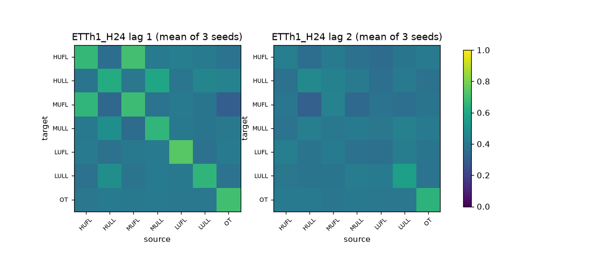

# S6 real data (ETTh1/ETTh2)

Gates commit `9ef1ded2d0e3b4e8b5a0e48ad5fcef8ff0105f55`. Standardized units (train-split statistics). Ratios are equal-seed mean MSE ratios with paired circular block bootstrap CIs (block 96 windows, 2000 resamples).

## ETTh1_H24 (final learned head: learned; iterated divergent: False; persistence val MSE 1.2637)

| Variant | test MSE | test MAE | per-seed MSE | median window MSE | best val | best epochs | cap hits | train s | ms/window |
|---|---:|---:|---|---:|---|---|---:|---:|---:|
| identity | 0.5730 | 0.4930 | 0.5735, 0.5760, 0.5696 | 0.4747 | 0.7255, 0.6965, 0.6867 | [20, 20, 20] | 3 | 616 | 39.11 |
| dense | 0.5582 | 0.4881 | 0.5478, 0.5682, 0.5585 | 0.4624 | 0.6700, 0.6895, 0.6673 | [20, 20, 20] | 3 | 589 | 38.77 |
| random | 0.5623 | 0.4888 | 0.5567, 0.5698, 0.5604 | 0.4664 | 0.6961, 0.7248, 0.6733 | [20, 20, 20] | 3 | 582 | 38.09 |
| learned | 0.5432 | 0.4824 | 0.5666, 0.5291, 0.5337 | 0.4486 | 0.6718, 0.6317, 0.6610 | [20, 20, 20] | 3 | 600 | 38.08 |
| var_direct | 0.9550 | 0.7381 | 0.9550, 0.9550, 0.9550 | 0.8753 | 0.9337, 0.9337, 0.9337 | [20, 20, 20] | 3 | 5 | 0.07 |
| dlinear | 0.3134 | 0.3564 | 0.3134, 0.3134, 0.3134 | 0.2539 | 0.3992, 0.3992, 0.3992 | [20, 20, 20] | 3 | 16 | 0.14 |

| Ratio | value | 95% CI | per seed |
|---|---:|---|---|
| learned/dense mse | 0.9731 | [0.9622, 0.9834] | 1.0344, 0.9312, 0.9556 |
| learned/dense mae | 0.9885 | [0.9844, 0.9924] | 1.0142, 0.9702, 0.9813 |
| learned/identity mse | 0.9479 | [0.9305, 0.9668] | 0.9880, 0.9187, 0.9370 |
| learned/identity mae | 0.9786 | [0.9692, 0.9884] | 0.9986, 0.9644, 0.9728 |
| learned/random mse | 0.9659 | [0.9548, 0.9773] | 1.0178, 0.9286, 0.9524 |
| learned/random mae | 0.9869 | [0.9819, 0.9921] | 1.0116, 0.9674, 0.9820 |
| learned/var_direct mse | 0.5687 | [0.5416, 0.5946] | 0.5933, 0.5541, 0.5588 |
| learned/var_direct mae | 0.6536 | [0.6347, 0.6731] | 0.6661, 0.6464, 0.6484 |
| learned/dlinear mse | 1.7329 | [1.6244, 1.8562] | 1.8078, 1.6883, 1.7027 |
| learned/dlinear mae | 1.3537 | [1.3127, 1.3948] | 1.3795, 1.3387, 1.3429 |
| dense/identity mse | 0.9741 | [0.9552, 0.9929] | 0.9552, 0.9866, 0.9805 |
| dense/identity mae | 0.9900 | [0.9798, 1.0004] | 0.9847, 0.9940, 0.9913 |
| var_direct/identity mse | 1.6666 | [1.5900, 1.7525] | 1.6652, 1.6581, 1.6767 |
| var_direct/identity mae | 1.4971 | [1.4483, 1.5498] | 1.4993, 1.4920, 1.5002 |
| dlinear/identity mse | 0.5470 | [0.5083, 0.5876] | 0.5465, 0.5442, 0.5503 |
| dlinear/identity mae | 0.7229 | [0.6997, 0.7479] | 0.7239, 0.7204, 0.7244 |

Target learned <= dense (point): **met**; CI-supported benefit: **yes**.
Learned graph: mean density 0.429; top-10 edge Jaccard across seeds [0.25, 0.429, 0.333]; mean across-seed std of edge probabilities 0.023. Top edges (lag, source->target, mean prob): L1 MUFL->HUFL 0.70; L1 HUFL->MUFL 0.66; L1 MULL->HULL 0.59; L1 HULL->MULL 0.50; L1 HULL->LULL 0.49; L1 LULL->HULL 0.45; L1 OT->HULL 0.44; L2 MUFL->HULL 0.44; L2 LULL->MULL 0.44; L2 HULL->MULL 0.43

## ETTh1_H96 (final learned head: learned; iterated divergent: False; persistence val MSE 1.5606)

| Variant | test MSE | test MAE | per-seed MSE | median window MSE | best val | best epochs | cap hits | train s | ms/window |
|---|---:|---:|---|---:|---|---|---:|---:|---:|
| identity | 0.6197 | 0.5204 | 0.6217, 0.6163, 0.6212 | 0.5795 | 1.0161, 1.0044, 1.0008 | [20, 20, 20] | 3 | 5361 | 49.53 |
| dense | 0.6064 | 0.5154 | 0.6057, 0.6042, 0.6093 | 0.5521 | 0.9856, 0.9739, 0.9790 | [20, 20, 20] | 3 | 703 | 52.51 |
| random | 0.6101 | 0.5169 | 0.6072, 0.6036, 0.6194 | 0.5619 | 0.9794, 0.9848, 1.0020 | [20, 20, 20] | 3 | 44434 | 59.40 |
| learned | 0.6044 | 0.5147 | 0.6095, 0.5939, 0.6098 | 0.5562 | 0.9866, 0.9744, 0.9821 | [20, 20, 20] | 3 | 7822 | 49.96 |
| var_direct | 1.0186 | 0.7726 | 1.0186, 1.0186, 1.0186 | 0.9741 | 1.1016, 1.1016, 1.1016 | [20, 20, 20] | 3 | 10 | 0.09 |
| dlinear | 0.3893 | 0.3996 | 0.3893, 0.3893, 0.3893 | 0.3569 | 0.6712, 0.6712, 0.6712 | [20, 20, 20] | 3 | 27 | 0.20 |

| Ratio | value | 95% CI | per seed |
|---|---:|---|---|
| learned/dense mse | 0.9967 | [0.9898, 1.0034] | 1.0063, 0.9829, 1.0009 |
| learned/dense mae | 0.9986 | [0.9956, 1.0016] | 1.0041, 0.9933, 0.9984 |
| learned/identity mse | 0.9753 | [0.9667, 0.9845] | 0.9805, 0.9636, 0.9818 |
| learned/identity mae | 0.9890 | [0.9840, 0.9944] | 0.9943, 0.9830, 0.9898 |
| learned/random mse | 0.9908 | [0.9840, 0.9977] | 1.0039, 0.9839, 0.9846 |
| learned/random mae | 0.9956 | [0.9923, 0.9991] | 1.0026, 0.9907, 0.9936 |
| learned/var_direct mse | 0.5934 | [0.5679, 0.6193] | 0.5984, 0.5831, 0.5987 |
| learned/var_direct mae | 0.6661 | [0.6472, 0.6860] | 0.6684, 0.6614, 0.6686 |
| learned/dlinear mse | 1.5527 | [1.4534, 1.6522] | 1.5658, 1.5256, 1.5666 |
| learned/dlinear mae | 1.2878 | [1.2504, 1.3237] | 1.2922, 1.2786, 1.2926 |
| dense/identity mse | 0.9785 | [0.9648, 0.9925] | 0.9744, 0.9803, 0.9808 |
| dense/identity mae | 0.9904 | [0.9832, 0.9979] | 0.9902, 0.9896, 0.9915 |
| var_direct/identity mse | 1.6436 | [1.5714, 1.7249] | 1.6385, 1.6526, 1.6398 |
| var_direct/identity mae | 1.4848 | [1.4403, 1.5329] | 1.4876, 1.4863, 1.4805 |
| dlinear/identity mse | 0.6281 | [0.5869, 0.6717] | 0.6262, 0.6316, 0.6267 |
| dlinear/identity mae | 0.7680 | [0.7440, 0.7928] | 0.7695, 0.7688, 0.7658 |

Target learned <= dense (point): **met**; CI-supported benefit: **no**.
Learned graph: mean density 0.430; top-10 edge Jaccard across seeds [0.25, 0.429, 0.333]; mean across-seed std of edge probabilities 0.023. Top edges (lag, source->target, mean prob): L1 MUFL->HUFL 0.70; L1 HUFL->MUFL 0.66; L1 MULL->HULL 0.59; L1 HULL->MULL 0.50; L1 HULL->LULL 0.49; L1 LULL->HULL 0.45; L1 OT->HULL 0.44; L2 MUFL->HULL 0.44; L2 LULL->MULL 0.44; L2 HULL->MULL 0.43

